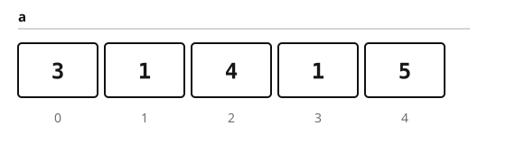

This chapter is deliberately small, but it is not empty. It exists to prove that the whole toolchain works end to end: prose, inline and display mathematics, a hand-drawn SVG figure, a TikZ diagram, syntax-highlighted code, callouts, tables, footnotes, and links between chapters.

If you are reading the built book, the page you are on was produced from a Markdown file, passed through KaTeX and TikZ, and then rendered to HTML, PDF, and EPUB. The [preface](chapter:preface#who-this-book-is-for) explains the larger plan.

## The array model

An array stores a sequence of values in contiguous memory. We write the elements as $a_0, a_1, \dots, a_{n-1}$, and we say that the array has length $n$. Accessing a single element by index costs $\bigO(1)$ time, which is the main reason arrays are the default building block for almost every data structure in competitive programming.



The sum of the first $k$ elements is called a **prefix sum**:

$$
S_k = \sum_{i=0}^{k-1} a_i, \qquad S_0 = 0.
$$

The definition is simple, but it unlocks a useful trick. Once every prefix sum is known, the sum of any contiguous subarray $a_l, a_{l+1}, \dots, a_{r-1}$ is just

$$
\sum_{i=l}^{r-1} a_i = S_r - S_l.
$$

That is the entire idea behind the prefix-sum technique.

::: definition Prefix sums
For an array $a$ of length $n$, the prefix-sum array is the array $S$ of length $n+1$ defined by

$$
S_0 = 0, \qquad S_k = S_{k-1} + a_{k-1} \quad (1 \le k \le n).
$$
:::

::: theorem Range-sum queries
After $\bigO(n)$ preprocessing, any range sum $a_l + \cdots + a_{r-1}$ can be answered in $\bigO(1)$ time.
:::

::: example A worked query
Suppose $a = [3, 1, 4, 1, 5]$. Then

$$
S = [0, 3, 4, 8, 9, 14].
$$

The sum of $a_1 + a_2 + a_3 = 1 + 4 + 1$ is $S_4 - S_1 = 9 - 3 = 6$.
:::

## Building the prefix array

The construction is a single left-to-right pass. We allocate $n+1$ slots, set $S_0 = 0$, and then add one element at a time.

```cpp
#include <bits/stdc++.h>
using namespace std;

vector<long long> prefix_sums(const vector<int>& a) {
    vector<long long> s(a.size() + 1, 0);
    for (size_t i = 0; i < a.size(); ++i) {
        s[i + 1] = s[i] + a[i];
    }
    return s;
}

int main() {
    vector<int> a = {3, 1, 4, 1, 5};
    auto s = prefix_sums(a);

    // Sum of a[1..3] = a[1] + a[2] + a[3]
    cout << s[4] - s[1] << '\n';  // 6
}
```

The loop touches each element once, so the running time is linear. The extra array uses $\bigO(n)$ memory. If the input values can be large, use `long long` for the prefix sums even when the original array fits in `int`.

::: complexity
Time: $\bigO(n)$ for preprocessing and $\bigO(1)$ per query.

Memory: $\bigO(n)$ for the prefix array.
:::

## A diagram of the construction

The figure below shows the same array and its prefix sums. The arrows follow the order in which the values are produced.

```tikz caption="Building a prefix-sum array from left to right." alt="An array of five cells above a prefix-sum array of six cells, connected by arrows."
\begin{tikzpicture}[
  cell/.style={draw, rounded corners=1pt, minimum width=1.1cm, minimum height=0.75cm, font=\ttfamily},
  sum/.style={draw, rounded corners=1pt, minimum width=1.1cm, minimum height=0.75cm, fill=green!12, font=\ttfamily},
  flow/.style={-{Stealth[length=2mm]}, semithick}
]
  \foreach \v/\i in {3/0, 1/1, 4/2, 1/3, 5/4} {
    \node[cell] (a\i) at ({1.35*\i}, 0) {\v};
  }
  \node[sum] (s0) at (0, -1.6) {0};
  \node[sum] (s1) at (1.35, -1.6) {3};
  \node[sum] (s2) at (2.70, -1.6) {4};
  \node[sum] (s3) at (4.05, -1.6) {8};
  \node[sum] (s4) at (5.40, -1.6) {9};
  \node[sum] (s5) at (6.75, -1.6) {14};

  \foreach \i in {0,1,2,3,4} {
    \pgfmathtruncatemacro{\next}{\i+1}
    \draw[flow] (a\i) -- (s\i);
    \draw[flow] (s\i) -- (s\next);
  }
\end{tikzpicture}
```

The top row is the input; the bottom row is the prefix array. Notice that the prefix array has one more cell than the input. The extra cell at the front is what makes the range formula $S_r - S_l$ work without a special case for $l = 0$.

## Choosing the right tool

Prefix sums are not the only way to answer range queries. The right choice depends on whether the array changes.

| Operation | Prefix sums | Segment tree | Fenwick tree |
| --- | --- | --- | --- |
| Build | $\bigO(n)$ | $\bigO(n)$ | $\bigO(n \log n)$ |
| Point update | $\bigO(n)$ | $\bigO(\log n)$ | $\bigO(\log n)$ |
| Range query | $\bigO(1)$ | $\bigO(\log n)$ | $\bigO(\log n)$ |
| Memory | $\bigO(n)$ | $\bigO(n)$ | $\bigO(n)$ |

If the array never changes, prefix sums are hard to beat. If updates are interleaved with queries, a Fenwick tree is usually the smallest and fastest option.[^fenwick]

[^fenwick]: A Fenwick tree stores partial sums in a way that makes both updates and prefix queries logarithmic. The name comes from Peter Fenwick's 1994 paper.

::: tip Zero-based indexing
Be consistent. If the input is zero-based, the prefix array should also be zero-based, with $S_k$ denoting the sum of the first $k$ elements. Mixing conventions is the most common source of off-by-one errors in range-sum code.
:::

::: warning Overflow
A prefix sum can be much larger than any individual element. If the array contains $10^5$ values near $10^9$, the total can exceed the range of a 32-bit signed integer. Use `long long` (or an arbitrary-precision type when the problem requires it).
:::

## Exercises

::: example Exercise 1
Given an array of $n$ integers and $q$ range-sum queries, answer all queries in $\bigO(n + q)$ time.
:::

::: example Exercise 2
Given a binary array, use prefix sums to count the number of ones in any subarray in $\bigO(1)$ time per query.
:::

::: example Exercise 3
Extend the idea to two dimensions. Build a matrix of prefix sums so that the sum over any axis-aligned rectangle can be answered in $\bigO(1)$ time.
:::

## What comes next

The prefix-sum array is a small example of a larger pattern: spend preprocessing time once, then answer many queries quickly. The same trade-off appears in sparse tables, segment trees, Fenwick trees, and offline query algorithms. In the next chapters we will meet those structures and learn when each one is the right fit.

For now, the important thing is that this chapter renders. If the mathematics, the two figures, the code block, and the table all appear correctly in HTML, PDF, and EPUB, the pipeline is doing its job.
