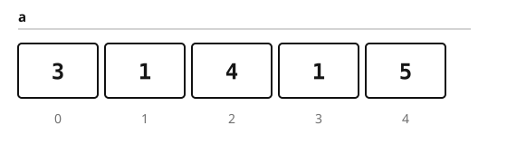

Summing a subarray looks like the simplest thing in the world: loop from $l$ to
$r$, add, done. It is also the first place where a beginner meets the real cost of a
query. With $q$ queries over an array of length $n$, that loop does $q(r-l+1)$ work,
and for $n = q = 10^5$ it is already $10^{10}$ additions — far past the one-second
limit.

%% add: The fix is one extra cell at the front of the array. I still remember how
%% add: annoyed I was that nobody had shown me this in my first contest.

The trick is to answer the same queries by subtracting two numbers we already
computed. This chapter builds that idea from the ground up, then uses it to motivate
the tree structures that come later.

## The array model

An array stores a sequence of values in contiguous memory. We write the elements as
$a_0, a_1, \dots, a_{n-1}$ and say the array has length $n$. Reading or writing one
element by index costs $\bigO(1)$, which is why arrays sit under almost every
structure in this book.



::: definition Prefix sums
For an array $a$ of length $n$, the prefix-sum array is the array $S$ of length
$n+1$ with $S_0 = 0$ and $S_k = S_{k-1} + a_{k-1}$ for every $1 \le k \le n$.
:::

The definition costs nothing to state. The payoff is the identity that follows: the
sum of a contiguous range $a_l, \dots, a_{r-1}$ is just the difference of two prefix
values,

$$
\sum_{i=l}^{r-1} a_i = S_r - S_l.
$$

%% link: the range-sum identity above -> pin:ch-01-eq-2

::: theorem Range-sum queries
After $\bigO(n)$ preprocessing, any range sum can be answered in $\bigO(1)$ time.
:::

## Building the prefix array

The construction is a single left-to-right pass. We allocate $n+1$ slots, set
$S_0 = 0$, and add one element at a time.

```cpp
vector<long long> prefix(const vector<int>& a) {
    vector<long long> s(a.size() + 1, 0);
    for (int i = 0; i < (int)a.size(); ++i) {
        s[i + 1] = s[i] + a[i];
    }
    return s;
}
```

%% artifact: prefix-sum-grid | Prefix sums filling in from left to right.
    Show a row of eight input cells above a row of nine prefix cells. A "step"
    control advances one cell at a time: the current input cell turns ochre, its
    running total pulses in the prefix row below, and the two cells it feeds are
    joined by a thin arrow. A "reset" control returns to $S_0 = 0$. The same
    running total is also drawn as a pointer on a number line underneath. Both rows
    must stay readable in grayscale.

::: complexity
Time: $\bigO(n)$ to build, $\bigO(1)$ per query.

Memory: $\bigO(n)$ for the prefix array.
:::

::: example A worked query
Take $a = [3, 1, 4, 1, 5]$. Then $S = [0, 3, 4, 8, 9, 14]$, and the sum
$a_1 + a_2 + a_3 = 1 + 4 + 1$ is $S_4 - S_1 = 9 - 3 = 6$.
:::

## A diagram of the construction

The figure below shows the same array and its prefix sums. The arrows follow the
order in which the values are produced.

```tikz caption="Building a prefix-sum array from left to right." alt="An array of five cells above a prefix-sum array of six cells, connected by arrows."
\begin{tikzpicture}[
  cell/.style={draw, rounded corners=1pt, minimum width=1.1cm, minimum height=0.75cm, font=\ttfamily},
  sum/.style={draw, rounded corners=1pt, minimum width=1.1cm, minimum height=0.75cm, fill=green!12, font=\ttfamily},
  flow/.style={-{Stealth[length=2mm]}, semithick}
]
  \foreach \v/\i in {3/0, 1/1, 4/2, 1/3, 5/4} {
    \node[cell] (a\i) at ({1.35*\i}, 0) {\v};
  }
  \node[sum] (s0) at (0, -1.6) {0};
  \node[sum] (s1) at (1.35, -1.6) {3};
  \node[sum] (s2) at (2.70, -1.6) {4};
  \node[sum] (s3) at (4.05, -1.6) {8};
  \node[sum] (s4) at (5.40, -1.6) {9};
  \node[sum] (s5) at (6.75, -1.6) {14};

  \foreach \i in {0,1,2,3,4} {
    \pgfmathtruncatemacro{\next}{\i+1}
    \draw[flow] (a\i) -- (s\i);
    \draw[flow] (s\i) -- (s\next);
  }
\end{tikzpicture}
```

The top row is the input and the bottom row is the prefix array. Notice that the
prefix array has one more cell than the input. That extra cell at the front is what
makes $S_r - S_l$ work without a special case for $l = 0$.

## Choosing the right tool

Prefix sums are not the only way to answer range queries. The right choice depends
on whether the array changes between queries.

| Operation | Prefix sums | Segment tree | Fenwick tree |
| --- | --- | --- | --- |
| Build | $\bigO(n)$ | $\bigO(n)$ | $\bigO(n \log n)$ |
| Point update | $\bigO(n)$ | $\bigO(\log n)$ | $\bigO(\log n)$ |
| Range query | $\bigO(1)$ | $\bigO(\log n)$ | $\bigO(\log n)$ |
| Memory | $\bigO(n)$ | $\bigO(n)$ | $\bigO(n)$ |

If the array never changes, prefix sums are hard to beat. If updates are interleaved
with queries, a Fenwick tree is usually the smallest and fastest option.[^fenwick]

[^fenwick]: A Fenwick tree stores partial sums so that both updates and prefix
queries are logarithmic. The name comes from Peter Fenwick's 1994 paper.

::: warning Overflow
A prefix sum can be much larger than any single element. With $10^5$ values near
$10^9$, the total passes the range of a 32-bit signed integer. Use `long long`, and
switch to an arbitrary-precision type when the problem demands it.
:::

%% link: the Fenwick tree, if updates are interleaved with queries -> https://cp-algorithms.com/data_structures/fenwick.html

One convention is worth fixing now: if the input is zero-based, keep the prefix
array zero-based too, with $S_k$ denoting the sum of the first $k$ elements. Mixing
the two conventions is the most common source of off-by-one errors in range-sum
code.

## Exercises

::: example Exercise 1
Given an array of $n$ integers and $q$ range-sum queries, answer all queries in
$\bigO(n + q)$ time.
:::

::: example Exercise 2
Given a binary array, use prefix sums to count the ones in any subarray in $\bigO(1)$
time per query.
:::

## What comes next

The prefix array is a small example of a larger pattern: spend preprocessing time
once, then answer many queries quickly. The same trade-off appears in sparse tables,
segment trees, Fenwick trees, and offline query algorithms. In the next chapters we
meet those structures and learn when each one is the right fit.
